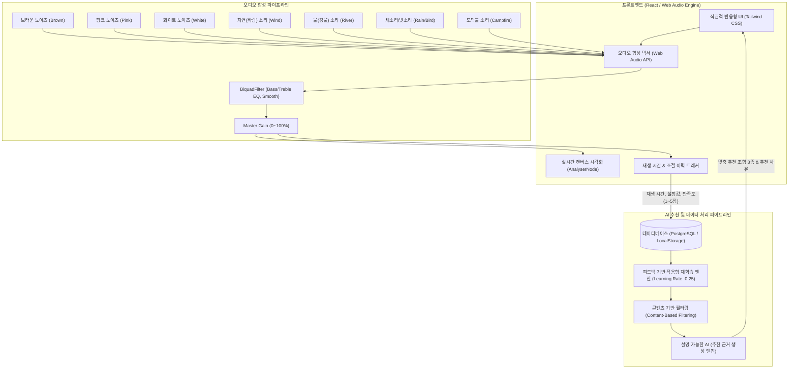

# AI 기반 개인 맞춤형 백색소음 추천 시스템 (AuraSound AI)

> **2026 인공지능 기초 실습 프로젝트**  
> **개발자**: 21030 한연수  
> **프로젝트명**: AI 기반 개인 맞춤형 백색소음 추천 시스템 (AuraSound AI)

---

## 1. 프로젝트 개요

현대인들은 학업, 업무, 수면, 심신 이완 등 다양한 목적으로 백색소음을 활용합니다. 그러나 기존의 백색소음 앱들은 이미 녹음된 단일 음원을 반복 재생하는 정적 방식에 그쳐, 개인마다 서로 다른 주파수 민감도(저음 선호, 고음 피로 등)와 청각적 취향을 반영하지 못했습니다.

본 프로젝트는 **사용자의 청각적 취향과 재생 시간, 만족도 피드백을 실시간으로 분석하여 개인에게 최적화된 백색소음 조합과 음향 밸런스를 스스로 학습하고 추천하는 AI 웹 애플리케이션**입니다.

### 🌟 핵심 차별점
1. **7채널 동시 합성 믹서**: 브라운, 핑크, 화이트 노이즈 및 자연소리 4종(바람, 강물, 비/새, 모닥불)을 실시간으로 합성 및 개별 비중 제어
2. **Web Audio API 오디오 엔진**: 고품질 프로시저럴(알고리즘) 합성 생성기와 실제 MP3 음원 파일 재생을 모두 지원
3. **적응형 강화 학습 추천 모델**: 1~5점 만족도 평가, 재생 시간 가중치, 세부 불만족 요인(저음/고음/단조로움)을 반영한 파라미터 자동 최적화
4. **설명 가능한 AI (XAI)**: 왜 이 소리 조합이 추천되었는지 근거와 이유를 자연어로 명확하게 제시
5. **실시간 음향 시각화**: Web Audio AnalyserNode 기반의 실시간 오디오 파형(Waveform) 및 주파수 스펙트럼(Spectrum) 시각화

---

## 2. 전체 시스템 아키텍처



---

## 3. 데이터베이스 구조 (Database Schema)

본 시스템은 정밀한 개인화와 모델 재학습을 위해 다음과 같이 정규화된 데이터베이스를 설계했습니다. (`database_schema.sql` 파일 제공)

### 주요 테이블 정의

| 테이블명 | 역할 및 저장 데이터 |
| :--- | :--- |
| **`users`** | 사용자 기본 식별자, 데이터 수집 동의 여부, 생성일 |
| **`sound_sources`** | 7가지 사운드 메타데이터 (주파수 기울기, 소음 차폐력, 이완 점수, 집중도 점수) |
| **`user_preferences`** | 사용자별 학습된 사운드 가중치(JSON), 선호 저음/고음 EQ, 학습 누적 횟수 |
| **`playback_sessions`** | 실제 재생 세션 (재생 시간(초), 활성 소리 비중 %, 볼륨, EQ 조절 횟수) |
| **`satisfaction_evaluations`** | 만족도 평가 (1~5점), 음량/저음/고음 밸런스 피드백, 단조로움 여부, 희망 추가/제거 사운드, 주관식 의견 |
| **`recommendation_history`** | AI 추천 결과 이력, 추천 사유, 신뢰도 점수, 사용자 반응(적용, 좋아요, 싫어요) |
| **`user_presets`** | 사용자가 커스텀하여 저장한 나만의 소리 프리셋 |

---

## 4. 7가지 소리 및 Web Audio API 합성 엔진

본 시스템은 외부 음원 없이도 브라우저 자체에서 100% 실시간으로 동작하는 **고품질 프로시저럴 오디오 합성 엔진**을 탑재하고 있으며, 동시에 사용자가 보유한 실제 MP3 파일을 원클릭으로 로드하여 교체할 수도 있습니다.

| 사운드 종류 | 음향 주파수 특성 및 합성 알고리즘 | 권장 사용 목적 |
| :--- | :--- | :--- |
| **브라운 사운드 (Brown Noise)** | 1/f² 특성의 저주파 노이즈 ($lastOut = \frac{lastOut + 0.02 \times white}{1.02}$). 묵직하고 따뜻함. | 깊은 몰입, 외부 잡음 차단, 수면 |
| **핑크 사운드 (Pink Noise)** | 1/f 뇌파 동조 특성 (Paul Kellet 6단 필터 알고리즘). 자연계 주파수 분포와 일치. | 숙면 유도, 뇌 피로도 완화 |
| **화이트 사운드 (White Noise)** | 전 가청 주파수(20Hz~20kHz) 균일 분포 ($[-1.0, 1.0]$ 균등 난수). | 사람 목소리 및 대화 마스킹 |
| **자연(바람) 소리 (Wind)** | 저역 통과 필터 + 0.5~2Hz LFO 진폭 변조로 부드러운 바람결과 나뭇잎 스침 구현. | 실내 답답함 해소, 상쾌한 분위기 |
| **물(강물) 소리 (River)** | 이중 밴드패스(250Hz~900Hz) 필터와 난류(Turbulence) 변조로 흐르는 시냇물 구현. | 긴장 완화, 스트레스 해소 |
| **새소리 / 빗소리 (Rain/Bird)** | 고주파 빗방울 임펄스 버스트 + 사인파 주파수 스윕(1.5kHz~3.5kHz) 새 지저귐. | 감성적 이완, 창의적 독서 |
| **모닥불 소리 (Fireplace)** | 저주파 럼블(Rumble) 노이즈 + 확률적 장작 타는 크랙클(Crackle) 팝핑 사운드. | 아늑한 공간감, 단조로움 탈피 |

---

## 5. AI 개인 맞춤형 추천 모델 알고리즘

### 5.1 콘텐츠 기반 필터링 (Content-Based Filtering)
각 사운드 $i$는 6차원 음향 특성 벡터 $\vec{F}_i$를 가집니다:
$$\vec{F}_i = [\text{저주파 비중}, \text{중고주파 비중}, \text{소음 차폐력}, \text{심리적 안정감}, \text{집중력 유도}, \text{역동성}]$$

사용자의 청각 취향 프로필 벡터 $\vec{U}$는 사용자별 선호 사운드 가중치 $w_i$와 재생 시간 가중치 $D$, 만족도 점수 $S$의 결합으로 형성됩니다:
$$\vec{U} = \sum_{i=1}^{7} w_i \cdot \vec{F}_i$$

### 5.2 피드백 기반 적응형 가중치 최적화 (Adaptive Reinforcement)
사용자가 세션을 청취한 후 만족도 점수 $S \in \{1, 2, 3, 4, 5\}$를 부여하면, 학습률 $\alpha = 0.25$와 재생 시간 가중치 $T_w = \min(1.5, \ln(1 + \frac{duration}{60}))$를 기반으로 각 사운드의 가중치 $w_i$가 다음과 같이 갱신됩니다:

1. **5점 (매우 만족)**:
   $$w_i^{(t+1)} = w_i^{(t)} + \alpha \cdot T_w \cdot r_i \quad (\text{단, } r_i \text{는 현재 세션에서의 사운드 } i \text{의 믹싱 비율})$$
2. **4점 (만족)**:
   $$w_i^{(t+1)} = w_i^{(t)} + 0.5 \cdot \alpha \cdot T_w \cdot r_i$$
3. **3점 (보통)**:
   $$w_i^{(t+1)} = w_i^{(t)} + 0.1 \cdot \alpha \cdot r_i$$
4. **2점 (불만족)**:
   $$w_i^{(t+1)} = \max(0.02, w_i^{(t)} - 0.5 \cdot \alpha \cdot r_i)$$
   - 불만족 요인 분석(예: 고음 날카로움 피드백 시 Treble EQ $-1.5\text{dB}$, Smoothness $+10\%$)
5. **1점 (매우 불만족)**:
   $$w_i^{(t+1)} = \max(0.02, w_i^{(t)} - 1.0 \cdot \alpha \cdot r_i)$$
   - 탐색(Exploration) 모드로 전환: 사용 빈도가 낮았던 대체 사운드 가중치를 강제로 부스팅하여 완전히 새로운 조합 제안

갱신 후 모든 가중치는 $\sum_{i=1}^7 w_i = 1.0$으로 정규화(Softmax/L1 Normalization)됩니다.

### 5.3 설명 가능한 AI (XAI) 추천 이유 생성 메커니즘
AI는 사용자에게 추천을 전달할 때 블랙박스가 아닌 명확한 인과관계를 설명합니다:
* **예시 문구**: *"최근 물소리와 브라운 사운드를 함께 사용했을 때 만족도가 높았으며(평점 4.8점), 저음이 풍부한 소리를 선호하는 경향(+2.5dB)이 발견되어 해당 조합을 추천합니다."*
* 단조로움 피드백이 있었을 경우: *"소리가 단조롭다는 피드백을 반영하여 생동감 있는 바람 소리와 모닥불 크랙클 효과를 가미했습니다."*

---

## 6. 화면 구성 및 사용자 경험 (UI/UX)

1. **대시보드 (메인 화면)**
   - 개인 맞춤형 소리 추천 원클릭 진입
   - 누적 피드백 수, 청취 시간, 최고 선호 사운드, 평균 만족도 통계
   - 오늘의 AI 추천 소리 하이라이트 카드
2. **소리 제작 화면 (스튜디오 / 믹서)**
   - 7가지 소리 선택 카드 (개별 토글, 0~100% 음량 슬라이더)
   - 실시간 믹싱 비율 게이지 및 범례 표시
   - 마스터 볼륨, 저음(Bass) 및 고음(Treble) EQ, 소리 부드러움(Smoothness) 조절
   - 2초 페이드 인 / 페이드 아웃 기능
   - HTML5 Canvas 기반 실시간 오디오 비주얼라이저 (파형 & 주파수 스펙트럼 모드 전환)
   - MP3 파일 직접 선택 연동 지원
3. **AI 추천 화면**
   - AI가 제안하는 3가지 맞춤 조합 카드
     * 1: 취향 몰입 베스트 믹스 (Deep Focus)
     * 2: 안정 & 이완 밸런스 믹스 (Calm Balance)
     * 3: 청각 리프레시 믹스 (Exploration)
   - 추천 근거(XAI) 박스 및 적합도(%) 점수
   - 원클릭 즉시 재생 및 믹서 적용, 좋아요/별로예요 투표
4. **만족도 평가 화면**
   - 별점 1~5점 직관적 선택
   - 소리 크기, 저음/고음 밸런스 선택 (적당함, 너무 큼, 날카로움 등)
   - 단조로움 여부 체크박스, 추가/제거 희망 사운드 드롭다운
   - 제출 즉시 AI 모델 파라미터 재학습 및 반영
5. **마이페이지 (취향 분석 & 통계)**
   - 사운드별 선호도 가중치 프로그레스 바 랭킹
   - 선호 주파수 및 EQ 프로파일 분석
   - 내가 저장한 소리 프리셋 관리
   - 최근 만족도 평가 및 청취 이력 로그
   - 데이터 백업 및 복원 (JSON 내보내기/불러오기)

---

## 7. 실행 방법

### 방법 1: 웹 브라우저에서 즉시 실행 (무설치)
1. 현재 폴더에 생성된 **`index.html`** 파일을 더블 클릭하여 Chrome, Edge 등의 브라우저로 엽니다.
2. 상단의 **[재생]** 버튼을 누르면 고품질 사운드 합성이 즉시 시작됩니다.
3. 스튜디오 탭에서 슬라이더를 조절하고, 만족도 평가를 제출하여 AI 모델이 학습되는 과정을 실시간으로 확인할 수 있습니다.

### 방법 2: Python 백엔드 API 서버 실행 (FastAPI)
Python 환경에서 REST API 서버를 구동하여 웹 클라이언트와 통신할 수 있습니다:
```bash
# 1. 의존성 패키지 설치
pip install -r requirements.txt

# 2. FastAPI 서버 구동
uvicorn backend_server:app --reload --port 8000

# 3. 브라우저에서 대화형 API 문서(Swagger) 확인
http://localhost:8000/docs
```

---

## 8. 산출물 파일 목록

| 파일명 | 파일 설명 |
| :--- | :--- |
| **`index.html`** | 완전한 프론트엔드 웹 애플리케이션 (Web Audio 7종 합성기, 반응형 UI, 비주얼라이저, AI 추천기) |
| **`recommendation_model.py`** | Scikit-learn/NumPy 기반 개인 맞춤형 백색소음 AI 추천 엔진 소스코드 |
| **`backend_server.py`** | FastAPI 기반 RESTful 백엔드 서버 소스코드 |
| **`database_schema.sql`** | PostgreSQL/SQLite 호환 데이터베이스 스키마 및 초기 메타데이터 쿼리 |
| **`requirements.txt`** | 백엔드 실행을 위한 Python 라이브러리 목록 |
| **`README.md`** | 전체 시스템 사양, 아키텍처 다이어그램, 수학적 추천 모델 보고서 |

